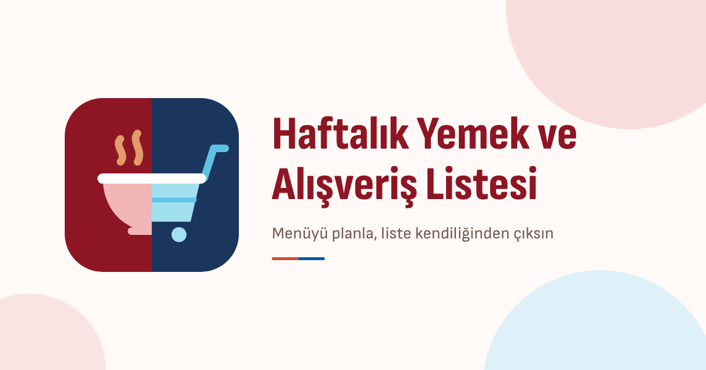
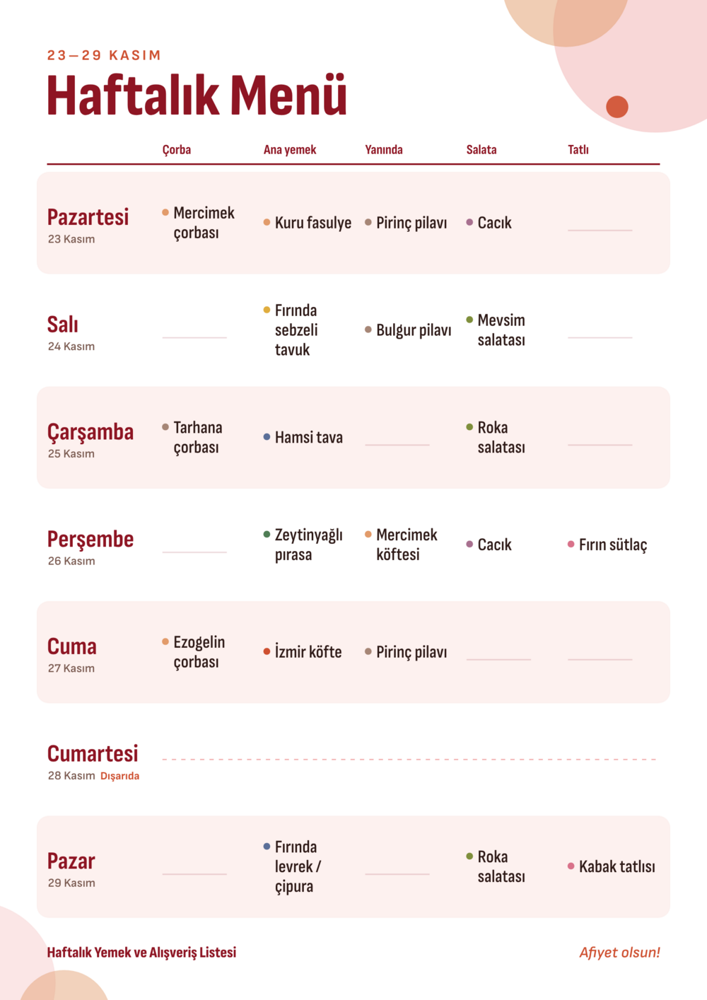

# Weekly Meal and Grocery Planner · Haftalık Yemek ve Alışveriş Listesi

**[Uygulamayı aç / Open the app →](https://cihan-senturk.github.io/weekly-meal-and-grocery-planner/)**

[Türkçe](#türkçe) · [English](#english)

## İnsanlığa Notum / My Note to Humanity
Bu projedeki her şeyi yapay zekaya yaptırdım. Hatta bu cümleler hariç bu ekrandaki yazıyı da yapay zeka yazdı. Bari iki satır kendim yazayım da o kadar da ayıp olmasın dedim. Bu konuda hassasiyetiniz varsa haberiniz de olmalı.

I had AI do everything in this project. In fact, aside from these specific sentences, even the text you see on this screen was written by AI. I figured I should at least write a couple of lines myself, it only seemed right. If this is something you're sensitive about, I thought you ought to know.

## Türkçe

**Ücretsiz haftalık yemek planlayıcı ve otomatik alışveriş listesi.** Kayıt yok, üyelik yok, reklam yok. Haftalık menünüzü seçin; market listesi kendiliğinden çıksın. Bilgisayarda planlayın, telefonla markete gidin.

İki sekmeden oluşur: **Yemek** sekmesinde haftanın menüsünü planlarsınız, **Alışveriş** sekmesi ise menüdeki malzemelerle markette alacağınız diğer her şeyi tek listede toplar.

### Neler yapabilirsiniz?

- **Menüden alışveriş listesine, tek adımda.** Yemekleri seçin; malzemeler kişi sayısına göre hesaplanıp reyonlara göre gruplanır.
- **Ücretsiz ve kayıt gerektirmez.** Hesap yok, e-posta yok. Siteyi ana ekrana ekleyip uygulama gibi kullanın.
- **Cihazlar ve kişiler arasında eşitleme.** Bilgisayarı ve telefonu QR koduyla eşleyin; aynı kodla ailenizle de paylaşın.
- **Boş şablon olarak da kullanılır.** Menüyü A4 olarak yazdırın; boş kutular elle doldurulacak çizgiler olarak basılır.
- **Mevsiminde yemekler.** Kasımda hamsi ve pırasa, temmuzda patlıcan öne çıkar.
- **Dengeli bir hafta için öneriler.** Balık, baklagil ve sebze önerileri; haftanız uydukça tik alır.
- **Kişi başı kalori ve makrolar.** Her gün için yaklaşık kalori, protein, karbonhidrat ve yağ.
- **Tek market listesi.** Deterjandan kuruyemişe 1000'i aşkın ürün arasından ekleyin; menünün malzemeleri de aynı listeye kendiliğinden gelir.
- **Markette kolaylık.** Satıra dokunup alındı işaretleyin; liste açıkken ekran kararmaz. "Alışveriş tamamlandı" deyince liste tarihiyle geçmişe kaydedilir.
- **İnternetsiz çalışır.** Market içinde çekmese bile menü ve liste açılır.
- **Kolay paylaşım ve düzenleme.** Listeyi WhatsApp'a gönderin; yemekleri sürükleyip taşıyın, "Geri al" ile geri getirin.
- **Gizlilik.** Reklam ve takip yok. Menünüz tarayıcınızda kalır; eşleme açılırsa eşlenen cihazlarla paylaşılır.

### Nasıl kullanılır?

1. [Uygulamayı açın](https://cihan-senturk.github.io/weekly-meal-and-grocery-planner/) ve kişi sayısını girin.
2. Haftanın günlerine yemek ekleyin (çorba, ana yemek, yanında, salata, tatlı).
3. **Alışveriş** sekmesine geçin: menünün malzemeleri hazır; markette alacağınız diğer şeyleri de ekleyin.
4. Telefonla kullanmak için üstteki cihaz simgesine basın ve çıkan QR kodunu telefonunuzla okutun.

İpucu: Sekme adının yanındaki 📌 ile uygulamanın hangi sekmeden açılacağını seçebilirsiniz.

### Kimler için?

- **Tek yaşayanlar:** Haftalık planla israfı ve "bugün ne pişirsem?" derdini azaltın.
- **Aileler:** Menüyü birlikte planlayın, listeyi eşleyin; markete kim giderse aynı listeyi görür.
- **Diyetisyenler:** Danışanlara yaklaşık kalori ve makrolarıyla örnek haftalık menü hazırlayıp çıktısını verin.
- **Toplu yemek yapılan yerler:** Yurt, kreş, pansiyon, şantiye ya da kamp mutfağı; 200 kişiye kadar miktarları otomatik hesaplayın.

*Anahtar kelimeler: haftalık menü, haftalık yemek listesi, haftalık yemek planı, yemek planlayıcı, menü planlayıcı, alışveriş listesi, market listesi, ücretsiz, kayıt gerektirmez, yazdırılabilir şablon, boş haftalık menü şablonu, aile yemek planı, market alışveriş listesi, toplu yemek menüsü, diyet menüsü.*

## English

**A free weekly meal planner with an automatic grocery list.** No sign-up, no account, no ads. Pick the week's dinners and the shopping list builds itself. Plan on your computer, shop with your phone. (The interface is in Turkish and the dishes are from Turkish home cooking.)

Two tabs: **Meals** for planning the week, **Shopping** for one grocery list that holds both the menu's ingredients and everything else you buy.

- **From meal plan to grocery list automatically**: ingredients are scaled to the number of people and grouped by supermarket aisle.
- **Free, no sign-up**: works in the browser; add it to your home screen to use it like an app.
- **Sync between devices and people**: pair a computer and a phone with a QR code, or share the code with family.
- **Printable blank template**: print the week as A4; empty slots print as lines to fill in by hand.
- **Seasonal by month**, **balanced-week tips** and **approximate calories and macros per person**.
- **One shopping list**: add from 1,000+ everyday products; the menu's ingredients join the same list automatically.
- **Shopping history**: mark a trip as done to save the list with its date and reuse it later.
- **Shopping mode**, **works offline**, **share as text or image**.
- **Who is it for?** People living alone, families sharing one list, dietitians preparing sample weekly menus, and any kitchen cooking for a group (dorms, nurseries, guesthouses, work sites; up to 200 people).
- **Private**: no ads, no tracking. Your plan stays in your browser unless you turn on device sync.

*Keywords: free meal planner, weekly meal plan template, weekly menu planner, grocery list, shopping list generator, no sign-up, printable meal planner, family meal planning, meal planner for dietitians, group cooking menu.*

## Teknolojiler / Technologies

- **HTML, CSS ve saf JavaScript** (ES modülleri; framework ve derleme adımı yok) · plain HTML, CSS and JavaScript, no framework or build step
- **GitHub Pages** ile barındırma · hosting
- **Firebase Cloud Firestore** (ücretsiz Spark planı) ile cihaz eşleme · device sync
- **Service Worker ve Web App Manifest** ile internetsiz çalışma ve ana ekrana kurulum · offline use and home-screen install
- **Canvas** ile yazdırılabilir A4 menü görseli · printable A4 menu image
- Besin değerleri: **USDA FoodData Central** · nutrition data · Yazı tipi: **Sofia Sans** (SIL OFL)

## Lisans / License

Uygulamayı kullanmak ücretsizdir. Kaynak kodun tüm hakları saklıdır: izin olmadan kopyalanamaz, değiştirilemez ve dağıtılamaz. Ayrıntılar: [LICENSE](LICENSE).

Using the app is free. The source code is all rights reserved: it may not be copied, modified or distributed without permission. See [LICENSE](LICENSE).
